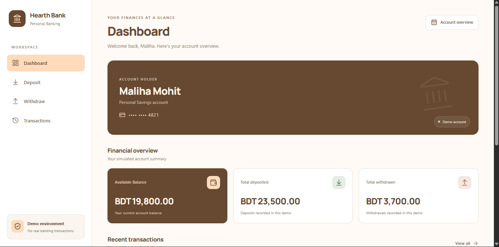
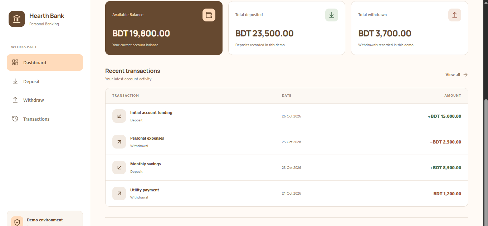
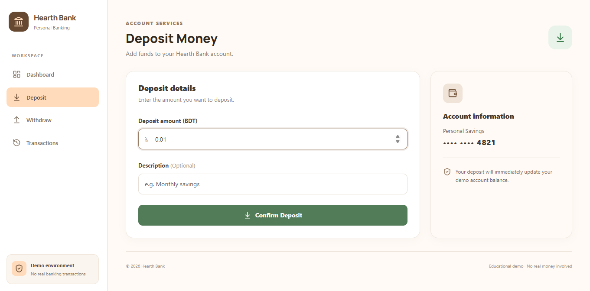
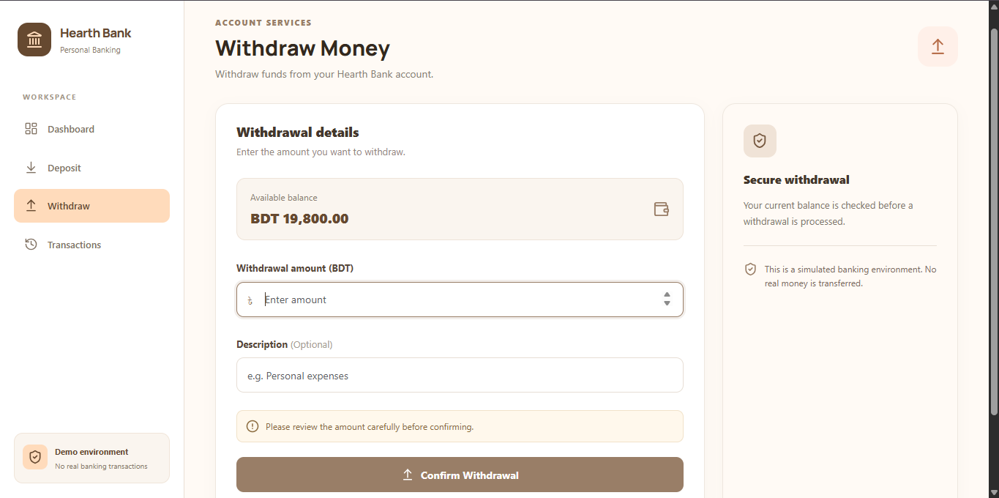
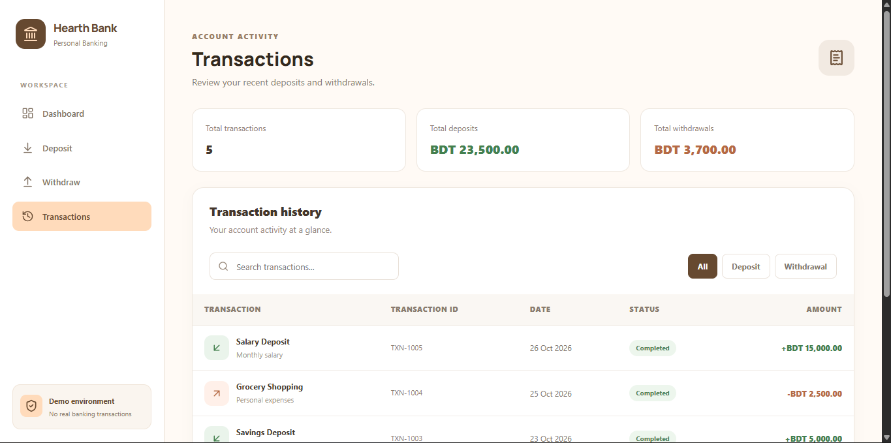

# Hearth Bank

A responsive banking dashboard simulation built with React. Hearth Bank provides a simple interface for viewing account information, managing simulated deposits and withdrawals, and reviewing transaction history.

> **Note:** This is a frontend educational project. It does not connect to a real bank, process real payments, or perform actual financial transactions.

## Screenshots

### Dashboard




### Deposit


### Withdraw


### Transaction History


## Features

- **Dashboard:** View account balance, total deposits, total withdrawals, and recent transactions.
- **Deposit:** Add a simulated deposit with an optional description.
- **Withdraw:** Make a simulated withdrawal with balance validation and a confirmation prompt.
- **Transaction History:** Review previous transactions.
- **Search and Filtering:** Find transactions using the available search and filter controls.
- **Shared State Management:** Manage banking data across pages using React Context API.
- **Local Storage Persistence:** Keep simulated account data in the browser after refreshing the page.
- **Form Validation:** Validate deposit and withdrawal amounts.
- **Responsive Layout:** Adapt the interface to different screen sizes.

## Technology Stack

| Technology | Purpose |
|---|---|
| React | User interface |
| Vite | Development server and build tool |
| JavaScript | Application logic |
| Bootstrap | UI styling utilities |
| Custom CSS | Application layout and styling |
| React Router DOM | Page navigation |
| Context API | Shared application state |
| localStorage | Browser-side data persistence |
| Lucide React | Icons |

## Getting Started

Follow these steps to run the project locally.

### Prerequisites

Make sure you have installed:

- [Node.js](https://nodejs.org/)
- npm (included with Node.js)
- Git

### 1. Clone the repository

```bash
git clone https://github.com/malihamohit1100/hearth-bank.git
```

### 2. Navigate to the project directory

```bash
cd hearth-bank
```

### 3. Install dependencies

```bash
npm install
```

### 4. Start the development server

```bash
npm run dev
```

Open the local URL displayed in your terminal to view the application.

### 5. Create a production build

```bash
npm run build
```

Vite generates the production-ready files inside the `dist/` directory.

## Project Structure

```text
bank-management/
│
├── public/
│
├── docs/
│   └── screenshots/
│       ├── dashboard.png
│       ├── dashboard2.png
│       ├── deposit.png
│       ├── withdraw.png
│       └── transactions.png
│
├── src/
│   ├── components/
│   │   ├── Navbar.jsx
│   │   └── BalanceCard.jsx
│   │
│   ├── context/
│   │   └── BankContext.jsx
│   │
│   ├── pages/
│   │   ├── Dashboard.jsx
│   │   ├── Deposit.jsx
│   │   ├── Withdraw.jsx
│   │   └── Transactions.jsx
│   │
│   ├── App.jsx
│   ├── index.css
│   └── main.jsx
│
├── .env.example
├── .gitignore
├── index.html
├── package.json
├── package-lock.json
└── README.md
```

## State Management and Data Persistence

Hearth Bank uses React Context API to share account information and transaction data between the application pages.

The application stores its simulated banking data in the browser's `localStorage`, allowing the data to remain available after a page refresh in the same browser.

This is client-side demonstration data. It is not stored in a backend database and should not be used for real financial records.

To reset the locally stored demo data, open the browser developer console and run:

```javascript
localStorage.removeItem('hearth-bank-data');
location.reload();
```

## Limitations

- No backend server or database integration.
- No real bank account connection.
- No actual money transfers or payment processing.
- No user authentication or authorization.
- Data is stored locally in the browser and is specific to that browser.

## Learning Outcomes

Through this project, I practiced:

- Building reusable React components.
- Managing shared state with Context API.
- Working with React Hooks such as `useState`, `useEffect`, and `useRef`.
- Implementing client-side routing with React Router.
- Handling forms and validating user input.
- Persisting application data with `localStorage`.
- Organizing a React project into components, pages, and context.
- Creating a responsive user interface.

## Author

**Maliha Mohit**

- LinkedIn: [Maliha Mohit](https://www.linkedin.com/in/maliha-mohit-4375842b6/)

---

*Hearth Bank is an educational frontend project developed for learning and portfolio demonstration purposes.*